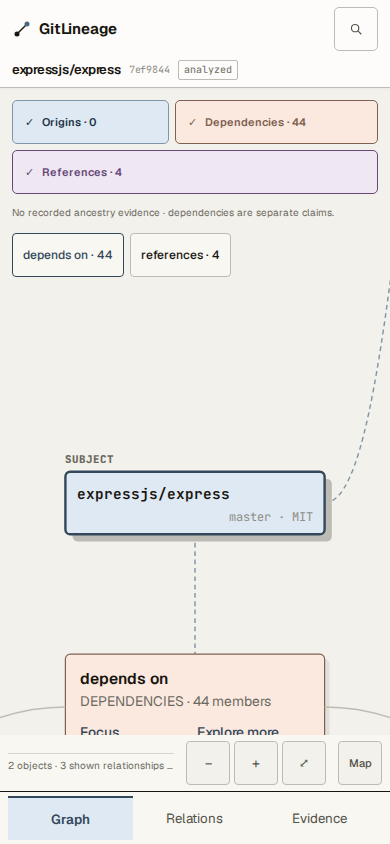
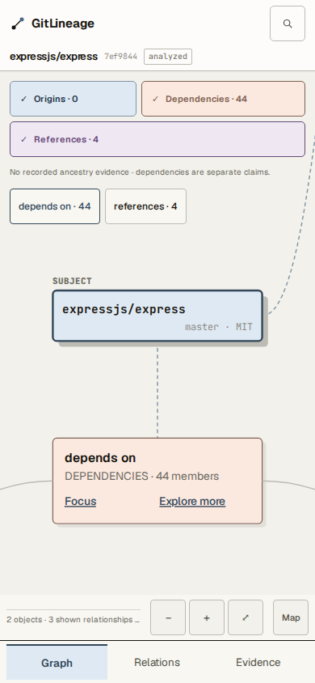

# 已有数据可见性与匿名探索成本修复

基线：main `6b73e6f6b62c10daab1df8e8db615961164a725a`。分支：`codex/exploration-usability`。本轮不部署、不修改服务或20/60额度，不增加请求预算、依赖、语言支持或血缘推断。

## 实际修复

- Explorer 已验证目录、当前固定 SHA、已读 manifest 和完整 History 的缓存返回先于新增请求额度检查。仅同一访客 Cookie、地址、任务有效期及已完成最终 ID/名称/SHA 核验的范围内可复用；未缓存操作仍逐次计费。失败请求不退款。额外路径/SHA参数拒绝，失败最终身份核验清空不可信内容。
- 初始 Explorer 复用 resolver 已取得的固定 head commit；不提前读取其他分支与父提交。父提交通过原有继续按钮、分支通过原有选择器内的“Read next branch tips”按需加载，不丢失查看其他分支的能力。History 根据剩余额度留出最终身份核验的一次请求；连“数据读取+最终核验”都容不下时，在派发前拒绝，保留此前已核验缓存。没有删除最终身份核验。
- 手机初始相机适配根节点和最近的现有关系分组，沿用原布局、分组、相机写入和后续展开行为。Express 的44项依赖分组、Focus和Explore more不再被底栏遮挡；不把48条关系全铺开。
- 空图、未取完搜索页、语言不支持、额度耗尽明确为未知/受限而非无关系。Registry失败记录`registry_lookup_failed`，与成功返回但没有repository字段区分；重复依赖去重不再误报覆盖截断。Canonical关系、方向、状态、Evidence ID和Discovery `pending/none`边界保持。

## 成本：同一固定传输、同一20地址/60全局预算

`cost.ts` 对真实service handler和比较worker执行操作，记录所有上游尝试和响应body字节。字节不含HTTP头。固定Git对象/元数据为离线语料，不是新一轮GitHub实测；Graph使用已有缓存，其成本不在匿名Explorer/Discovery池。两版输入与额度相同，原始逐请求记录为`cost-before.json` / `cost-after.json`。

| 路径 | 修复前 请求/响应字节 | 修复后 请求/响应字节 | 可完成范围 |
|---|---:|---:|---|
| A Graph缓存→Explorer→src→首次History→重开src | 20 / 3595 B | 14 / 2432 B | 前版History最终核验遇限、缓存也429；新版7个已核验commit和src可读，重开src新增0请求 |
| B Discovery→源码清单→人工每仓1文件→比较 | 16 / 2640 B | 16 / 2640 B | 两版1/1文件对完成；未修改比较引擎或安全复核 |
| C 连续三个仓库Explorer→src | 20 / 3154 B | 19 / 2835 B | 前版仅首仓src完成；新版3个根目录、2个src完成，第三src因至少需2次而429且新增0请求 |

初始Explorer从12次降至5次主要来自延迟尚未请求的历史/分支与复用已取head，不等于取得相同数量历史对象的纯压缩。A新版首次显式History保留6个父提交+head，旧版先预读6个再尝试下一页，不能把二者称为全量History等量工作。C三个完整src探索仍需21次，大于20；没有解决连续任意探索的服务策略问题。B保留最终身份核验，未发现足够安全的小范围优化，因此成本不变。

真实网络对照仅复用先前公网`yocto-queue`→`samverschueren/yocto-queue`收据：搜索5、清单10、比较5，共20次/125617 B、2/2文件对完成、实际源码2709 B。它来自历史发布证据，不是本轮重新执行；4文件对场景因下一次最终metadata核验没有余额而受限的原始失败不删除。本轮未消耗线上或GitHub额度。

## 缓存429与安全反例

`test/exploration-usability.test.ts`覆盖：20/20下同任务已验证目录200、0新增上游请求、仍20/20；未缓存目录429；错误Cookie、代理地址、Origin、CSRF、过期任务、非法路径、额外SHA及未知revision拒绝且0请求；内部错误仓库ID/SHA不能复用；最终身份变化清空缓存；余额不足时新操作派发前拒绝；余额2时1个父提交+最终metadata核验后安全返回partial。原始红灯`cache-red.log`保留。

## 六份历史真实图谱的生产Bundle回放

快照日期为2026-10-03至22日，不代表GitHub今日完整状态。`browser-before.json`、`browser-after.json`保留节点视口交集、分组坐标、URL文本和错误。初始截图使用相同视口/缓存；修复后使用真实点击/触摸模拟展开折叠组、Focus、键盘Explore more，不以dispatchEvent当可点击证明。下表节点不含分组卡片；因此Express的1个可见节点同时配有可点击44项依赖分组，并非仍只有根节点可探索。

| 样本 | Canonical/View关系 | 初始可见节点1280/390/430（前→后） | 现有分组总数 | 实际展开后可见节点1280/390/430 |
|---|---|---|---:|---|
| grpc/grpc | 47/42 | 11/3/3 → 11/5/5 | 3 | 14/7/7 |
| vitest-dev/vitest | 102/102 | 8/2/2 → 8/2/2 | 8 | 11/9/8 |
| expressjs/express | 48/48 | 7/1/1 → 7/1/1 | 2 | 11/4/4 |
| nachocebey/is | 21/21 | 8/2/2 → 8/2/2 | 2 | 10/8/8 |
| octocat/spoon-knife | 0/0 | 1/1/1 → 1/1/1 | 0 | 1/1/1 |
| sindresorhus/yocto-queue | 4/4 | 5/2/2 → 5/3/3 | 1 | 5/5/4 |

Spoon-Knife没有关系，保留单节点并提示本次有界分析未发现。其余5仓在3尺寸均有可达关系/分组入口，实际展开成功；18场景无页面异常、横向溢出，无外部浏览器请求。展开保持有限分页，不保证所有关系同时进入视口。

Express同尺度390×844对照：

专项`test/web/initial-neighborhood-acceptance.ts`量测stage、SVG CTM、world focal、对象bounds、elementFromPoint多点命中及44px手机触控区；真实Focus点击后键盘展开，检查相机、URL节点选择、有限分页、页面错误与溢出。接入原`test:mobile`，既有ARM64 M2及Stable UI会真实执行。真实红灯是390px Explore more右下角被底部工具栏挡住，保留`initial-entry-red.log`；不是把旧断言改成通过。测试开发中两个不适用断言（桌面强制44px、已有多个分组的总成员数绝对上限）改为手机触控及单次分页增量，并保留原日志。既有History浏览器检查显式点击继续和读取分支后，继续检查原有父关系、分支选择、返回、焦点和Motion；原始依赖预读的失败日志保留，未删除原有交互断言。既有History单测从“初始化预读6个”改为“显式读取6个父提交”，merge parent/window/final identity断言仍保留；不一致的同SHA双fixture修正为同一不可变commit。

## 验证与限制

- 本地Typecheck、全量Unit、Production Build通过。651项：648通过，3个live integration在未启用`GITLINEAGE_LIVE=1`时按既有设计跳过；没有新增跳过，也未把离线测试说成实时上游结果。
- 缓存安全、History预算、Registry诊断及去重测试均包含在全量Unit中。Express三尺寸专项浏览器通过；六样本18场景实际点击回放完成。Canvas、Landing、Analysis、Preflight、stale A→B、UI Contract、Responsive、Mobile、Site Continuity/History Return、Discovery V3/V4/Admission、Exploration及Unification最终回归通过；逐套日志见本地`regressions/`。Deep Search（21场景）和Spatial Routing也通过，汇总见`VALIDATION.md`，精确PR CI状态在PR/最终交付报告记录。
- 本轮Chromium移动宽度是模拟，不是实体触控认证；没有声称WebKit、iOS Safari或用户亲自体验已通过。
- 没有改Graph Schema/API版本、持久状态格式、认证规则、生产配置、20/60额度或Discovery文件/字节预算。未发现证据错绑回归。
- 搜索仍为既有有限查询/分页；JS/TS之外仍不支持比较。20次仍不能保障三个完整普通探索或任意多文件比较。相似性仍不能证明复制、派生或来源。
- 反过度工程化检查：只有已有模块局部修改；无新生产子系统、依赖、持久存储、索引或通用调度框架。成本脚本是一次交付的可复现证据，不新增运行服务。

本轮收益是已有内容在额度耗尽时可继续读、初始探索减少过早请求、手机能看到并进入真实分组。建议在相关CI通过且人工Review确认缓存安全边界后合并；发布仍需独立授权与针对性匿名入口检查，当前线上/Beta保持原样。
